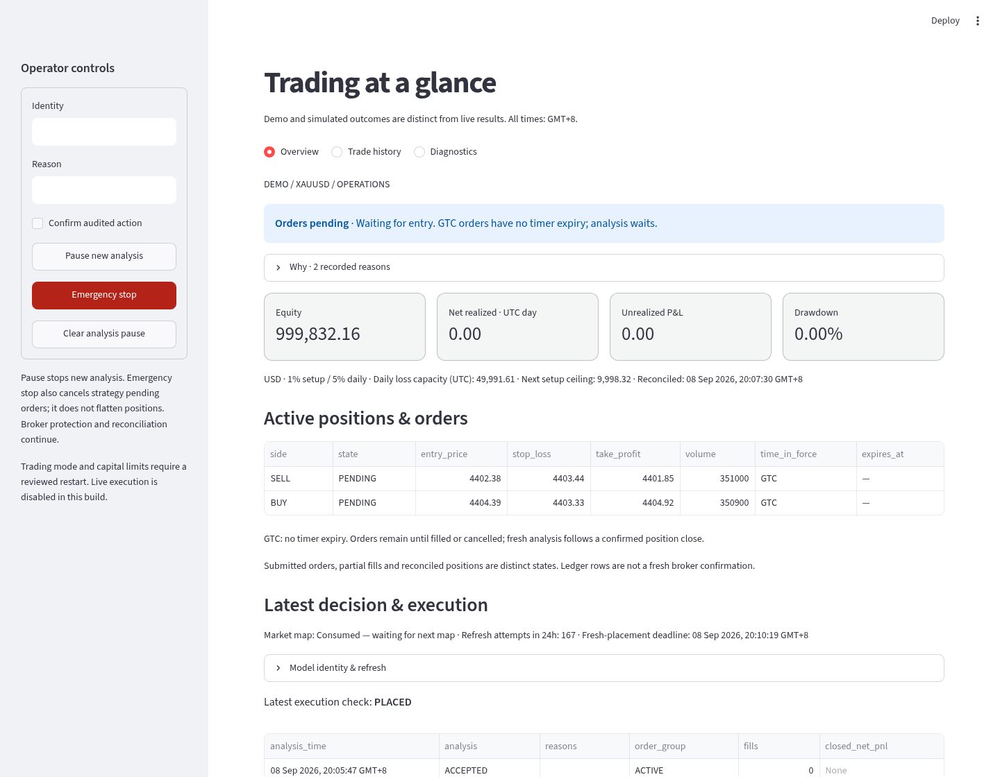

# Fixed trend-direction entry — ISSUE-372

New setups use **one STOP_LIMIT in Codex's original BUY/SELL direction**, or WAIT.
The four mode buttons and control-token dialog are removed; dashboard polling is
read-only. Existing groups finish with their original immutable mode/protection.
TP and dynamic half-leg sizing are unchanged; no 1:10 payoff or larger lots are
activated. [Contract and verification](docs/fixed-stop-limit-report.md).
Earlier four-mode and release descriptions below are historical.

# Four entry modes — ISSUE-370

The same demo bot now supports operator-selected **OCO stop-limit, OCO limit,
single stop-limit and single limit**. LIMIT uses BUY at the lower range / SELL at
the upper; single LIMIT reverses Codex at the SAME original trigger. WAIT remains
WAIT. Initial selection is single limit, per the operator request. Dashboard
buttons require the existing control token and persist selection across restarts.
Accepted orders retain their original mode and protection. Each leg keeps its
half-setup allocation inside the shared 1% cap; native equal-distance SL/TP and all
safety gates remain. No guaranteed reversal profit or automatic promotion.
See [contracts, controls, tests and rollout](docs/entry-modes-report.md) and
[delivery receipts](https://github.com/AegisFintech/scalping-bot/issues/370).

# Historical directional source — ISSUE-368

The approved source uses Codex BUY / SELL / WAIT, M15/M5 trend context and a nearby
completed-M1 range. Only the selected side can submit one protected STOP_LIMIT/GTC
entry. The other range edge is a structural reference, never a peer order.
The entry keeps its former half-setup allocation (at most 0.5% current equity)
inside the unchanged 1% setup ceiling; native opposite-box stop/equal gross TP
and all execution/reconciliation gates remain. No reversal, martingale, chase,
local profit-close or automatic strategy promotion. Matching main/worker rollout
and natural evidence are recorded in [issue #368](https://github.com/AegisFintech/scalping-bot/issues/368).

The frozen baseline review has 33 closed demo trades / 13 wins / 20 losses,
net −$3,208.32 with fees included. This is not proof that reversing wins. A bounded
read-only sampled-path observer supports a separate exit proposal; it cannot
trade and is not another trading bot. See [release, evidence and rollback](docs/directional-entry-report.md), and
[the exact exit proposal for review](docs/directional-exit-proposal.md).

# Historical M1-first activation — ISSUE-366

The operator authorized nearby M1 range selection after 42/42 v7 responses were
WAIT during the first 57 minutes. The new v8 guidance accepts observable brief
M1 consolidations; higher-timeframe/FVG conflicts are context rather than automatic
vetoes. TP/risk/execution gates are unchanged. Delivery includes testing, merging
`main`, deploying and verifying the one existing demo bot; retained artifacts are
history/rollback, not a second trading system. All 1,551 tests and local quality/security
gates passed; hosted checks and activation follow. Status and evidence:
[M1 range release](docs/m1-range-release-report.md).

# Historical evidence-first activation — ISSUE-364

Activated **22 October 2026, 15:50 Singapore**: `0.4.3-evidence-scalp.1-codex.1`,
Codex v7 and isolated worker transport 1.3. Indicators/DOM/costs inform Codex;
the compression scanner no longer blocks inference. Codex proposes OCO or WAIT;
WAIT reviews require 60 seconds and a newer completed M1. Daily persistent
threads and compaction retain context, while fresh evidence and deterministic
shared 1% risk remain authoritative. The first natural call returned WAIT after
a bearish structure break; no new-release fill is claimed. All 1,547 source tests
and both source-head hosted checks passed. Same history/database, additive WAIT
migration only; no reset or real-money activation. See the
[deployment receipt and monitoring limits](docs/evidence-demo-rollout-report.md).

# Historical source delivery — ISSUE-362

The new demo source sends completed M1/M5/M15 technical, structure, broker DOM,
spread/cost context and up to eight reconciled recent outcomes to Codex without
compression/ATR strategy admission. Codex proposes an OCO box or explicit WAIT.
Successful WAIT reconsideration needs 60 seconds and a newer completed M1;
failed/unknown requests retain the five-minute cooldown. Daily persistent Codex
threads retain context and compact after eight completed turns. Fresh evidence
and deterministic shared 1% risk, broker protection and reconciliation remain
authoritative. Source implementation is not runtime activation or evidence of
profitability. Qualification passed 1,547 tests plus all required checks; synthetic
subscription thread reuse/compaction passed. See [implementation and checks](docs/evidence-first-codex-report.md).

# cTrader scalper

For scheduled prospective comparison alongside demo trading, see the
[read-only forward observer](docs/forward-observer-report.md). It freezes future
daily windows and candidate definitions, records costs from actual trades
separately, and never places orders or automatically changes the strategy.

A Debian-compatible, AI-assisted XAUUSD analysis and execution system. The model
proposes prices; deterministic code controls money, validation and execution.
**Live submission is disabled. The tested strategies have not demonstrated
positive net expectancy.**

For bounded entry/TP research, use the [paired replay workflow](docs/paired-replay-report.md).
It compares frozen observed demo opportunities, checks archived quote integrity,
and reports missing paths and unknown economics explicitly. It does not change
trading, claim exact counterfactual net returns, or automatically promote a strategy.

Current source: strategy `0.5.0-directional-scalp.1-codex.1`, policy
`0.5.0-directional-scalp.1`, provider prompt `entry-direction-v1`, request 1.5 /
response 1.2. Codex selects a trend-continuation side or WAIT. Indicators and DOM
inform its judgment without a deterministic scanner/trend/ATR strategy filter.
Only demo implements the new single-entry submission; other adapters fail closed.
Accepted historical OCO groups retain their original two-entry lifecycle.
The bot operates continuously during the broker session, waiting safely when
orders/positions, cooldowns, stale data, unavailable sessions, reconciliation,
protection or affordability prevent a new setup. Demo records daily/high-water
losses without applying loss locks to admission; other modes retain them.

The dashboard is a single read-only, full-window animated landscape desk. It has
no sidebar, top navigation or separate history/diagnostics screens. Recorded
decisions, current action, scoped closed net and independently verified broker
P/L/protection remain visible. Backend authenticated operational controls are
retained. See [lean dashboard and configuration](docs/lean-dashboard-report.md).

Accepted strategy-owned pending orders are **good till cancelled (GTC)**, without
timer expiry. The loop is analyze → pending entry pair → fill/cancel peer →
SL/TP close → fresh analysis. No paid refresh runs while orders or a position
is active.
Fresh placement deadlines and all risk/reconciliation gates still apply.
See [the persistent-order lifecycle and rollout](docs/persistent-order-loop-report.md).

See the [provider recovery and no-orders incident](docs/provider-recovery-report.md),
[current risk-policy and recovery report](docs/risk-budget-recovery-report.md) and
[scenario implementation evidence](docs/reusable-scenario-report.md).
The [pending-order reconciliation repair](docs/pending-order-reconciliation-report.md)
accounts for broker-reported zero P/L on unfilled orders, preventing the erroneous
immediate safety cancellation observed in `0.2.2-fixed-risk.3`.

The original [completed-candle directional research](docs/scenario-automation-report.md)
remains a separate observe/replay tool. Its hold/failed-reclaim confirmations and
simulated structural/time closes are not the production OCO trigger rule.
`npm run scenario:observe -- artifacts/scenario-observation.json` makes one
potentially chargeable observation without broker submission authority.
`npm run scenario:replay -- tests/fixtures/scenario/manual-levels-synthetic.json artifacts/scenario-replay.json`
is a synthetic software check, not evidence of strategy performance.

## Overview



The dashboard is one full-window landscape page: recorded decisions, observed
current action, completed charts, reconciled equity and separate realized/open net
P/L. Browser polling shares one bounded background reader; stale or unavailable
evidence is withheld. The animated DOM persists across updates. No sidebar,
settings forms, top navigation or separate history/diagnostics pages remain.
Authenticated operational controls remain on the execution API.
The screenshots below document earlier releases; current behavior and validation
are in the [lean desk report](docs/lean-dashboard-report.md).

[Trade history screenshot](docs/images/equity-sizing-history-light.png)

[Dark theme screenshot](docs/images/provider-recovery-overview-dark.png) ·
[Refresh and contrast validation](docs/dashboard-refresh-report.md)

Broker-declared holiday closures now participate in completed-candle gap checks.
Unexplained missing open-session bars still block execution. Persistence failures
are visible as **Blocked**, survive restart, and back off analysis while protective
maintenance continues. Exact chart PNGs are stored by hash in protected local
storage; back up `.runtime/analysis-charts` together with PostgreSQL.

## Safety and money management

- Paper is the default mode; emergency stop starts active and automation is off.
  Credentials never authorize demo or live trading.
- One strategy setup at a time. Other-symbol account exposure, partial fills,
  unknown orders and incomplete reconciliation block new risk. Manual orders
  are never cancelled. Maintenance selects only the configured account/symbol.
- The fixed policy permits **up to 1% total setup risk**. The **5% daily loss**
  threshold is enforced outside demo and remains measured in demo.
  Both OCO legs share the setup budget, including simultaneous-fill race exposure.
  Production strategy spread/ATR filters were removed in ISSUE-086.
- Sizing reserves round-trip commission and 30 points of modeled adverse execution,
  floors broker-native volume, and respects remaining daily limits outside demo.
  No absolute starting-equity floor or artificial notional cap is required.
  Broker margin and volume limits still apply; one full modeled setup loss is
  reserved in free margin. Risk is recalculated from current equity immediately
  before placement. Collateral is distinct from stop risk. Broker margin tier changes
  trigger bounded downward sizing with exact-volume confirmation.
  Minimum volume is rejected when unaffordable. Stops cannot cap gap losses.
- Cash-flow-adjusted high-water accounting survives restarts. Drawdown/daily
  losses can reduce risk to half or quarter outside demo; a 5% drawdown lockout
  remains recorded but is not enforced during demo development.
  Recovery is bounded and documented in the [risk model](docs/risk-model.md).
- Protective maintenance has its own serialized two-second loop. Slow inference
  cannot block expiry, peer cancellation or recovery. Broker-held protections
  continue during model outages. Emergency stop does not flatten positions.

## Model and decision path

Production proposals use subscription-authenticated Codex, requested `gpt-6.1-sol`,
through an isolated worker. No API-key fallback is used; returned backend identity,
usage and cost remain unknown. See [Codex integration](docs/codex-production-report.md).

Local analysis uses **720 M1 / 576 M5 / 480 M15 completed bars**, causal
BOS/MSS/order-block/FVG/sweep evidence and available broker depth. The compact
Codex input includes recent candle rows plus derived multi-timeframe context,
source timing and DOM limitations; it is not a consolidated exchange order book.
Codex receives numeric data, not screenshots. Prompt `entry-pair-v6` requests only
two entry prices; deterministic code owns SL, TP, sizing and execution. More
history or indicators do not establish better accuracy or profitability.
Every response crosses
strict schema, identity, tick-precision and fixed-validity checks. Requests have a
90-second background deadline, no automatic retry, bounded bodies and a circuit breaker.

A durable database claim prevents duplicate provider requests. Failure/unknown
dispatch retries retain a five-minute backoff; a fully reconciled position close
can authorize a fresh context, subject to every current gate including the
60-minute loss cooldown. No refresh bypasses an active group or cooldown. Pending orders/open positions suppress requests. A proven local circuit block is rechecked after
one minute without bypassing earlier requests or making a paid retry. Local
execution can evaluate every five seconds (with a
five-second candle-rollover reserve), without waiting for inference. A map can
produce one OCO intent. Crossed levels, insufficient reward, short remaining
validity or consumed maps wait without another paid call. Individual decisions
still require fresh quotes, matching completed-candle context and full account,
spread, fee, margin and risk approval. A proposal must be submitted within its fresh three-minute deadline and original
map validity. Once accepted, production pending orders use GTC without timer expiry.
The [1/3/5/10/15-minute research](docs/order-expiry-research-report.md) does not
establish a profitable or optimal lifetime; filled positions retain their SL/TP.

Broker STOP_LIMIT orders handle triggers. This is retail event-triggered execution
with a polling decision loop, not institutional HFT. `DEFERRED` means waiting;
`REJECTED` retains actual validation failures. Neither means orders are open.

## Configuration and migration

The normal [.env.sample](.env.sample) has **16 settings**.
It contains deployment identity, credentials/endpoints and explicit trading authorization. Stable internals are fixed in a typed policy, not another
operator tuning file. Conflicting legacy overrides produce errors naming keys
without printing values. Broker symbol/contract metadata remains authoritative.
The exact Codex model, AI and strategy policy are fixed in reviewed code. Optional
observability is deployment-only configuration. The authorized local migration reduced the populated `.env` from **176 to
24** entries after removing the obsolete fixed-dollar notional setting, preserving all other values. Its
four additional entries preserve deployment credentials. See the
[historical migration evidence](docs/equity-sizing-recovery-report.md).

For an existing installation, **do not overwrite `.env`**. Read the
[configuration inventory and migration instructions](docs/configuration.md), then:

```sh
npm ci
npm run config:check -- .env.sample
npm run config:check -- .env
npm run config:check -- .env --startup
npm run build
```

The policy check rejects conflicting legacy settings; `--startup` also checks
execution configuration, including explicit demo capital limits. Neither check
contacts the broker or authorizes trading. Keep secrets in ignored mode-0600 files
or a credential store. Migration
`0015` is additive and must be applied as a separate reviewed rollout while new
analysis is paused. Historical migrations and audit data remain intact.

Node 22 and Python 3.13 are the deployment baselines. Install Python dependencies
from `requirements.lock`. Headless services and hardened systemd units are in
[systemd/](systemd/); see [Debian deployment](docs/deployment-debian.md) and the
[operations runbook](docs/operations-runbook.md). Docker is not required.

## Reproducible research and validation

Read-only demo learning review (no trading or provider calls):

```sh
npm run demo:learning-review -- 0.3.0-fade-limit.3 2026-09-25T01:23:01.040Z 2026-10-02T01:23:01.040Z
```

This exposes signed costs, entry-time EMA alignment, approved-budget ratios and
model/effective entry displacement without rewriting trades. The isolated entry
guidance candidate is **not deployed**. Current quote-adjacent entry replacement
must be reviewed before a prompt-only trial can establish entry improvement.
See [measurement definitions and findings](docs/demo-learning-review-report.md).

```sh
# Read-only export, scoped by existing account identity; never exports broker IDs.
npm run evaluation:export -- 0.1.0-actionable-oco-auto-demo.43 artifacts/legacy-plans.json
.venv/bin/python -m python.evaluation.cli .runtime/market-data artifacts/evaluation.json \
  --legacy-plans artifacts/legacy-plans.json --until-ms 1788743999922
# Paid, bounded inference only; local archived inputs are required.
npm run provider:benchmark -- artifacts/benchmark-inputs.json artifacts/provider-results.json
```

The quote evaluator verifies manifests, rejects unordered/nonfinite data, removes
ambiguous timestamps, uses earlier completed sampled minutes, and evaluates
frozen candidates on two chronological holdouts. It models bid/ask, execution
latency, stop-limit nonfills, adverse fills, commissions, partial-fill scenarios,
and model-cost sensitivity. Missing paths are censored; total P&L is withheld
when exposure cannot be resolved. These recordings are sampled quotes, not a
complete tick tape. M1 fixtures and smoke tests are not profitability evidence.

At audit, demo release `.43` had 23 closed trades and **−11.88 net after fees**.
The faster candidates also lost on their observed closed outcomes. Archived
legacy plans had only one holdout fill, too little for an old-versus-new strategy
conclusion. Full metrics, uncertainty, source citations and limitations are in
[the report](docs/overhaul-report.md) and [evidence](docs/evidence/quote-evaluation.json).

Run the complete gates described in [testing](docs/testing.md), including Node
and Python checks, PostgreSQL migration/integration tests, schema/fail-closed
checks, secret scanning and dependency audits. Repository delivery rules are in
[AGENTS.md](AGENTS.md) and bounded work is tracked in [plan.md](plan.md).

## Repository upkeep and server footprint

Use `/root/scalping-bot-terminal` for development. Running services use immutable
releases under `/opt/ctrader-ai-scalper/releases`; editing this checkout does not
deploy changes. The original `/root/scalping-bot` and older worktrees retain frozen
research/source history. Preserve their records and registrations.

Run `npm run hooks:install` once in a development clone. Before each branch push,
the tracked `.githooks/pre-push` requires **README.md and AGENTS.md updates in each
new non-merge commit**, a clean tracked working tree and successful
`graphify update .`. Graphify runs locally with AST extraction; its ignored outputs
are navigation aids, not trading authority. Install Graphify separately before
pushing, and fetch `origin/main` before the first branch push. Existing custom
hooks are never overwritten. Local Git hooks are opt-in, not a remote enforcement
boundary; qualification and required GitHub review/checks still apply. Tags and
branch deletions do not rebuild the graph. Never use a hook to delete files,
rewrite commits, push changes or restart trading services.

The [cleanup inventory and receipt](docs/server-cleanup-report.md) records retired
unregistered research schedules, removed Claude/OpenCode tooling and reproducible
caches. Active bot/Codex/monitor/storage services, registered research, accepted
GTC orders, current data and immutable deployment artifacts remain protected.
Review unused files/dependencies as part of each update and record the result.
Server cleanup is an explicit reviewed operation, never an automatic push action.
