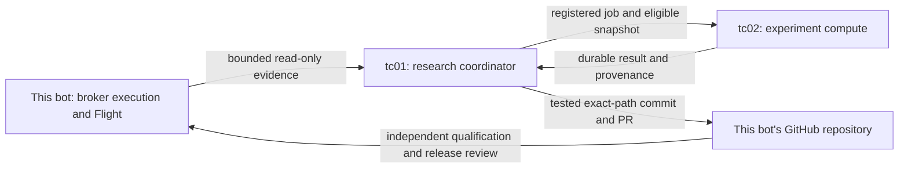

# One scalping bot with distributed research — approved plan

Issue: [#398](https://github.com/AegisFintech/scalping-bot/issues/398).
Status: **operator approved implementation; staged delivery in progress**.
The original inspection below is a source-pinned historical review. Current
implementation status is recorded in `plan.md` and each batch report.
Operator clarification: combine INTO this bot; tc01 and tc02 are research machines.
The existing scalper remains the primary repository and sole broker runtime.

## What the inspection established

Inspected scalper main `3ea7df3dbac1a4762af59a7b755ba88a598cdaf2` and remote
Aurum/XAUUSD main `35854ce652eb6541760c553f9176fbf5bae223fa`, which matched
GitHub at inspection. Remote cleanup deletions, generated graph changes and
untracked data/reports were preserved. Source, working-tree state and runtime
observations are distinct. No trading configuration, strategy, orders, provider
requests, remote source, account history or deployment was changed by this review.

The requested local SSH alias `tc01` was added with the existing Linux key path;
config/key permissions are0600 and batch login worked. This updates this server's
SSH configuration, not the operator's Windows PC. No key, hostname/IP, private
configuration or account identity is copied into repository evidence.

Aurum has useful durable research plans, preregistration, separate compute jobs,
result interpretation, source/evidence provenance, unknown-job recovery and tested
engineering proposals. It does not yet demonstrate a working unattended discovery
loop: at05:06:42 UTC on28 October its120 retained autonomous cycles had zero
supported autonomous findings, zero qualified candidates and75% failed tool calls
among the latest20. Two verified software repairs are a different outcome.
Repeated unknown-tool names and malformed plans are observed completion problems,
not evidence of a lack of indicators. These are retained-window measurements,
not a claim that no historical learning ever happened.
See the [pinned source and runtime review](evidence/xauusd-harness-review-20261028.md).

The scalper supplies stronger broker lifecycle truth: deterministic decimal risk,
independent native protection/reconciliation, exact journal authority and a
SELECT-only Flight recorder. Its existing research is not a ready-made0.8 bridge:
[`feed.py:20`](../python/research/feed.py) pins0.3.0-fade-limit.3;
[`paired.py:87–136`](../python/backtest/paired.py) accepts entry-pair1.0,
exactly two LIMIT/GTC legs and shared1% risk. The current source uses one
STOP_LIMIT/GTD, model-selected protection and capture-relative expiry. Aurum's
next-open/fixed-unit OHLC paper model does not simulate intrabar TP/SL. Neither
old simulator can establish current broker scalping results unchanged.

Both repositories' main-branch protection APIs returned **Branch not protected**;
both ruleset lists were empty. In the earlier scalper delivery, `--auto` merged
while checks were still running; actual activation waited for success. A future
publisher must enforce exact-head checks and review rather than trust that flag.
The active Aurum engineering implementation edits source in place after tests;
it does not commit/push. The legacy commit helper uses `add -A`/`--no-verify`
and has no observed production caller. Do not reuse it as the publisher.

## Target ownership

| Role                  | Owns                                                                                                                              | Does not own                                                                                       |
| --------------------- | --------------------------------------------------------------------------------------------------------------------------------- | -------------------------------------------------------------------------------------------------- |
| Existing trading host | Session, live observations, demo account/risk state, orders, native protection, reconciliation, journal, Flight and dashboard     | Long-running experiments or generated-code execution                                               |
| tc01                  | Research agenda, source verification, preregistration, evidence index, lessons, result interpretation and isolated PR preparation | Broker credentials, mutable account state, running-source writes or unilateral economic activation |
| tc02                  | Heavy replay, bounded experiments, immutable eligible dataset snapshots and content-addressed results                             | Broker submission, hidden-holdout publication or promotion authority                               |

These are roles of **one system**, with changes delivered to `scalping-bot`.
Import selected Aurum research modules after characterization; do not run a second
paper/demo execution stack as this bot's controller. Existing paper results can
inform discovery but remain labelled paper. Preserve the xauusd repository,
source history, dirty work and frozen experiments. Retire superseded schedules
only after a proven handover; no bulk merge/deletion is proposed.

## Research loop and information to combine

1. **Observe:** ingest all scoped outcomes, including WAIT/rejection/nonfill,
   expiry, open and partial exposure, manual interventions where proven and gaps.
2. **Diagnose:** separate entry quality, model latency/quote crossing, native
   execution/slippage, costs, protection, expiry and tooling failures. A sampled
   favorable move is not an available profitable broker close.
3. **Register:** one falsifiable changed rule, pinned code/data/cost assumptions,
   baseline, all-trial budget and rejection criteria before inspecting outcomes.
4. **Run:** tc02 evaluates eligible chronological data and execution-aware replay;
   retain uncertainty and negative results. Never invent a historical alternate
   AI request stream or copy hidden holdout into a prompt.
5. **Interpret:** exact completed result becomes an evidence-backed positive or
   negative finding, and its plan closes. Server-assigned provenance determines
   whether this was autonomous learning. Tool activity and self-written summaries
   do not count as learning outcomes.
6. **Propose:** isolated issue worktree, tested exact-path commit, push and PR.
   Economic strategy changes remain separately versioned and reviewed before one
   qualified release; research cannot change active groups or risk.

The evidence contract should join completed M1/M5/M15/SMC context, causal broker
DOM and per-side quotes, exact provider availability and broker events, approved
versus actual protection, fees and sampled Flight excursions. Measure latency to
fill/expiry, sampled time profitable, near-TP observations, favorable/adverse
excursions, reversals before exit, actual net and coverage. Keep broker IDs and
credentials local; exchange stable opaque evidence references, decimal strings,
source/protocol hashes and explicit clock/unknown fields. DOM is broker-local,
not a consolidated gold order book or proof of future liquidity/queue position.

Store broker truth on the existing host, research metadata/lessons on tc01 and
large eligible compute snapshots/results on tc02. Exchange bounded deltas and
hashes rather than clone all logs or raw prompts onto every host. Seven-day
operational-log rotation remains separate from retained learning/audit evidence.
No mutable database merge or accounting reset is needed.

## Bounded implementation order

| Batch | Work / dependency                                                                                            | Reviewable completion criterion                                                                                                                                                        |
| ----- | ------------------------------------------------------------------------------------------------------------ | -------------------------------------------------------------------------------------------------------------------------------------------------------------------------------------- |
| 0     | Source/authority inventory, included in #398/#399                                                            | Exact source, active jobs, dataset/cost clocks, frozen windows and protected account/symbol-overlap check; one executor remains authoritative                                          |
| 1     | Repair completion using [xauusd#22](https://github.com/AegisFintech/xauusd/issues/22)                        | Typed tool catalog/examples/plan shape and actionable errors; one fresh genuinely autonomous result→finding→close, with measured failure share and latency; no manufactured success    |
| 2     | [#399 evidence bridge](https://github.com/AegisFintech/scalping-bot/issues/399)                              | Versioned current-release read-only exports and idempotent research ingestion agree on denominators; invalid clocks/symbols/source, partial/gap/unknown cases tested                   |
| 3     | [#400 scalping replay](https://github.com/AegisFintech/scalping-bot/issues/400), depends on2                 | Additive single STOP_LIMIT/GTD lifecycle, factual baseline matching, current decimal costs and censored paths; old frozen pair studies unchanged; predeclared chronological evaluation |
| 4     | [#401 isolated publisher](https://github.com/AegisFintech/scalping-bot/issues/401), can begin with1/2        | Restricted worktree/test/publisher identities, exact-path commits, restart-safe push/PR receipts, independently enforced exact-head checks; no access to broker/control state          |
| 5     | [#402 distributed research loop](https://github.com/AegisFintech/scalping-bot/issues/402), depends on1–4     | tc01 agenda drives tc02 jobs and interprets fresh results into attributable findings and tested PRs; independently measured supported learning progress                                |
| 6     | [#403 dashboard/release integration](https://github.com/AegisFintech/scalping-bot/issues/403), depends on2–5 | One desk separates broker/demo/paper/replay/learning/software evidence; preregistered forward comparison and compatible reviewed release/rollback path                                 |

Reuse [#304](https://github.com/AegisFintech/scalping-bot/issues/304) for candidate
inventory, [#289](https://github.com/AegisFintech/scalping-bot/issues/289) for
measurement and [#290](https://github.com/AegisFintech/scalping-bot/issues/290) for
protocol. DOM/SMC work belongs with existing#327/#349. Historical native TP
uncertainty remains#388; copying a research engine cannot resolve broker execution.
Aurum#19 is separate uncertain-demo recovery, not a reason to enable its executor.

## Idle scheduling, self-committing and promotion

Idle is research opportunity, not permission to interfere with monitoring.
The trade loop and protection stay independent. tc01 wakes on new evidence,
completed jobs or due review; tc02 runs bounded compute. At market closure, new
entry analysis still stops while eligible offline research may continue. Reuse
existing compute orchestration after verifying current capacity; its retained
16-CPU capability report is not a new independent machine-health probe.

Keep research and entry Codex threads separate. Supply compact relevant approved
lessons, not the full archive or unreviewed instructions, and fresh market context
for each entry decision. Model memory is not model-weight training. An upgraded
plan supplies capacity; it does not establish edge or unlimited usage. Bound job
concurrency, attempts, deadlines, bytes and resource use; report tokens/cost as
unknown when not attested. Research cannot consume resources required for trade
maintenance or force a new order to obtain observations.

Autonomous commit/push/PR is the useful first engineering capability. Safe approved
engineering changes may proceed through independent checks under the existing
merge policy; risk/order authority, protection, evaluation criteria and economic
strategy releases need separate reviewed evidence. An agent cannot change its own
verifier/tests/permissions to pass. Do not transplant root `--yolo`, root SSH keys
or in-place self-deployment into trading authority. Unknown jobs/pushes/orders are
reconciled rather than blindly resent. Preserve all13 parked historical unknown
research jobs and their dependent plans.

Initial questions should be narrow and tied to actual failures: is an entry too
late after inference; do accepted setups have short after-cost favorable
excursions followed by reversals; does a supplied structure/DOM feature add
incremental evidence; does pending expiry preserve freshness? Test one variable
at a time. Do not optimize win rate or frequency alone: retain after-cost
expectancy, loss magnitude/tails, drawdown, trade count, stress sensitivity and
coverage. A fixed trade/day count is not qualification. No increase to current
risk, TP/SL limits, polarity or trade-forcing is part of this plan.

## Planning verification

Graphify query and direct source/primary GitHub inspection completed on both
repositories. Remote snapshot and limitations are linked above. Planning checks passed: scoped Prettier, relative-link validation, `git diff --check`
and `bash scripts/secret-scan.sh`. Runtime source fingerprint remains identical
to qualified0.8 (`348c6afddbd64c282a8012b8864007073ff58fc2b75ac242342da5ece4582879`).
Runtime tests were not rerun locally for this documentation-only plan; hosted
qualification and exact PR receipt follow in#398. No runtime strategy test, training run,
provider request, broker command, setting change or deployment is claimed.
